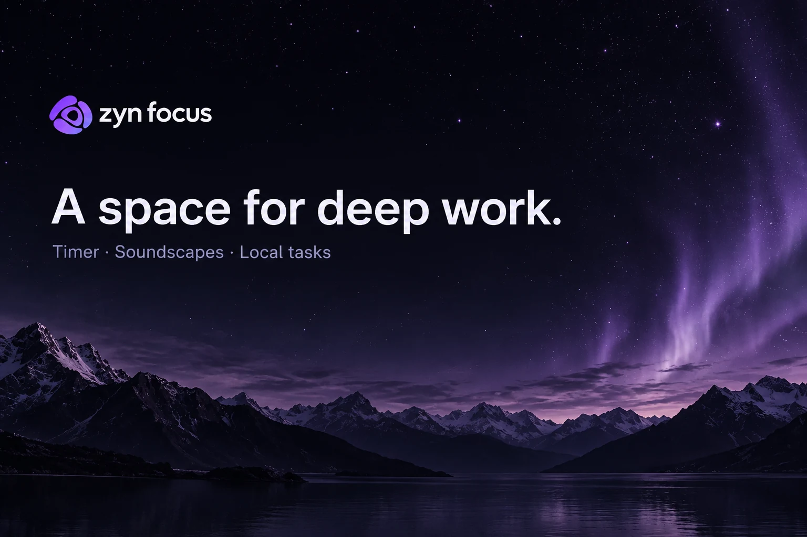
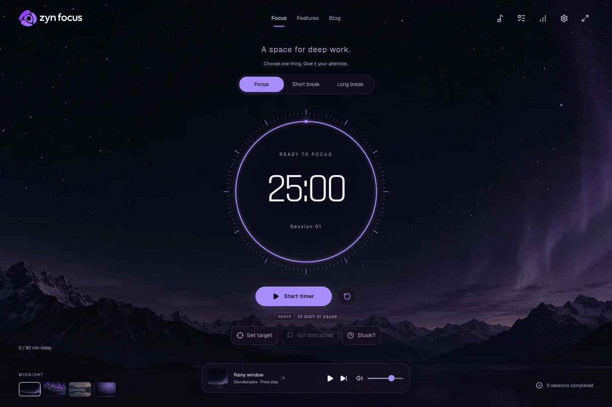
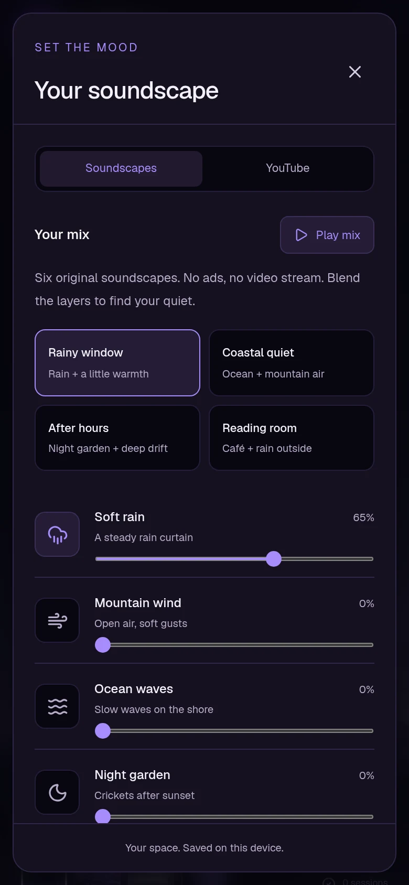

# Zyn Focus

A quiet Pomodoro workspace with original soundscapes, local tasks, and focus notes.

[Open Zyn Focus](https://focus.zynoks.com/) · [Getting started](guides/getting-started.md) · [Help](guides/troubleshooting.md)

For studying, writing, and independent work: choose one task, give it a focused stretch of time, and take a break. No account is needed. Tasks and session notes stay in the browser or app installation where you create them. There is no cloud sync.

This repository contains product information, pictures, and user guides. Application source code is maintained separately and is not included here.

## What you can do

- Run focus sessions, short breaks, and long breaks with adjustable durations, pause/resume, and optional automatic starts.
- Blend six original soundscapes: Soft rain, Mountain wind, Ocean waves, Night garden, Quiet café, and Deep drift. Start with a saved mix or adjust each layer, then set a sleep timer.
- Create tasks with priorities, project labels, session estimates, and a small next step. Select a task for your next session.
- Set an optional session target, log distractions, and save a reflection when you finish. Use smaller-step help when you get stuck.
- Track completed focus time, daily goals, project totals, and a weekly summary. Park thoughts for later, try a breathing reset, or close the day with tomorrow's first task.
- Choose four scenes and five accent palettes, reduce motion, or hide extra controls in immersive mode.
- Export a local backup and preview it before confirming a restore. Prepare the website workspace and bundled sounds for offline use.

Saved YouTube links open on YouTube. In-app video playback and live search are currently unavailable.

## A look inside

*Actual website screenshot, captured in a fresh browser profile. The cover above is generated promotional artwork, not an application screenshot.*

*The mobile picture shows the website in a phone-sized browser viewport. It is not a screenshot of the Android app. See [image credits and provenance](assets/README.md).*

## Platforms and downloads

| Platform | Availability |
| --- | --- |
| Website | [Available now](https://focus.zynoks.com/) in a modern browser. Desktop and phone layouts are available. |
| Installed web app | Optional browser installation and offline download. Support depends on your browser and device. |
| Android | An internal preview APK exists: version 1.0.1, build 3, Android 8.0 or newer. There is no approved public APK download in this repository. |
| Native Windows, Linux, macOS, or iOS app | No verified distributable release. Use the website where supported. |

There is no verified app-store listing to link here. Android notifications, precise session alarms, background audio controls, and a home-screen widget are implemented in the internal app; full testing on a physical phone remains outstanding. These are not browser features.

You do not need an installer to use the website. See [installation and updates](guides/installation.md) and [release status](RELEASES.md) for the distinction between the live website and internal Android builds.

## Your first session

1. Open [focus.zynoks.com](https://focus.zynoks.com/).
2. Open Tasks, add one task, and select it for focus. This step is optional.
3. Choose Focus, adjust durations in Settings if needed, and press **Start timer**. On a keyboard, Space starts or pauses the timer when you are outside a form or dialog.
4. Open the sound controls to choose a mix and press play. Closing those controls keeps ambient audio playing while you stay in the workspace.
5. Take the break when the session finishes. Optionally review the session and leave a next step.

The [getting-started guide](guides/getting-started.md) covers targets, reviews, and ending the day.

## Keep your work safe

Each browser profile and app installation has separate data. Website and Android backups use different formats and cannot be exchanged. Storage and backup files are not encrypted by Zyn Focus. Browser storage can be removed by private browsing, site-data clearing, or storage eviction.

Export a backup before clearing data, changing installations, or uninstalling. Restore replaces the current workspace after confirmation. [Backup, restore, and uninstall guide](guides/backup-and-restore.md).

## Updates and limits

Open the website to receive its current pages. For an offline workspace, use **Apply update & reload** in Settings when offered. Reloading stops audio; the saved timer deadline recovers. Android preview updates require a compatible signed APK; source changes do not update an installed app.

- There is no account, cloud backup service, device sync, or general live editing sync across browser tabs.
- Browser alerts require the page to remain open and permission where applicable. Returning after a missed deadline reconciles a completed session; it does not invent sessions for the time you were away.
- Navigating from the workspace to another site page stops its audio. The saved timer can recover on return.
- Offline use needs an initial download. Uncached pages and external websites still need internet.
- Local storage is not a secure vault. Exported backups can contain task names and private notes.
- Browser layout checks and Android emulator checks do not establish full physical-device or independent accessibility validation.

See [FAQ](guides/faq.md) and [troubleshooting](guides/troubleshooting.md).

## Support and notices

For bugs or ideas, use this repository's **Issues** tab. Include your platform and steps to reproduce. Do not upload passwords, tokens, private notes, personal backups, or identifying screenshots. For private support or security reports, email [contact@zynoks.com](mailto:contact@zynoks.com).

[Website](https://focus.zynoks.com/) · [Focus guides](https://focus.zynoks.com/blog) · [Contact](https://focus.zynoks.com/contact) · [Privacy](https://focus.zynoks.com/privacy) · [Terms](https://focus.zynoks.com/terms) · [Third-party notices](https://focus.zynoks.com/licenses)

See [rights and credits](RIGHTS.md). This repository does not grant an open-source license to the application.
